<!-- A copy of profile/README.md (the organization page's), with paths from the root, so the repo page shows it too.
     Bento tiles: drawn in bento/tiles.html, rendered to profile/bento/v3/ by `node bento/build.mjs`.
     Rows run right to left, like the page they stand for. Each row adds up to 1000px of design. -->

<a href="https://nimbyte.ir">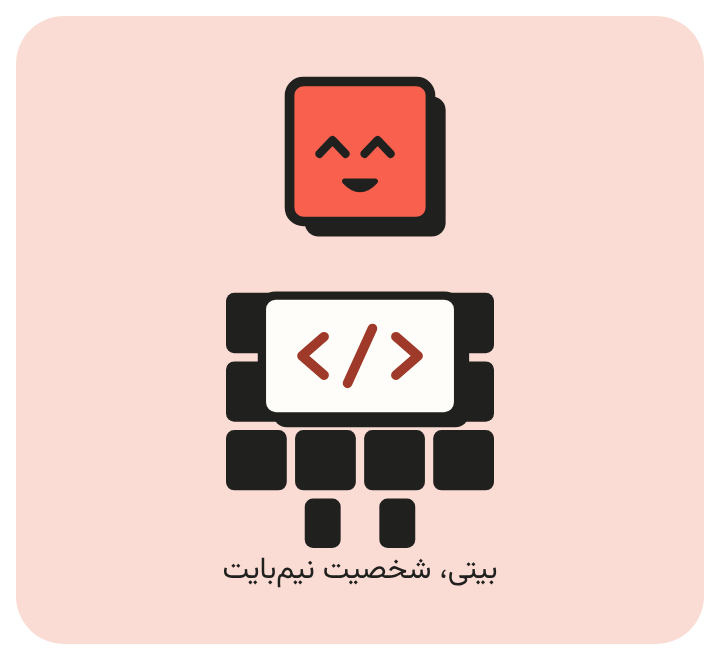</a><a href="https://nimbyte.ir">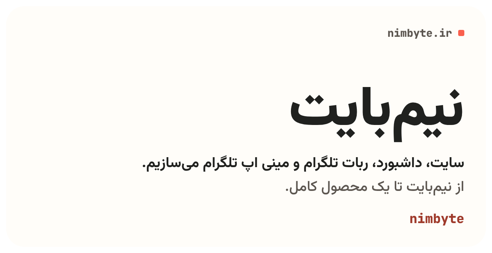</a> <a href="https://nimbyte.ir/services/animated-stickers">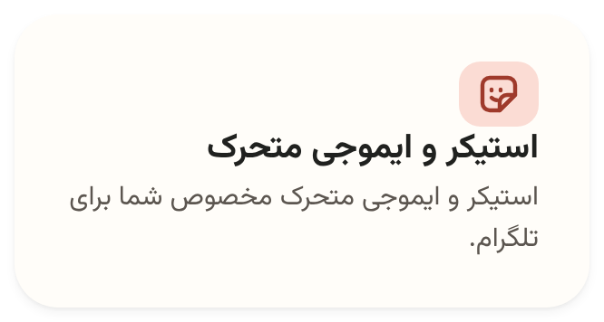</a><a href="https://nimbyte.ir/services/telegram-bots">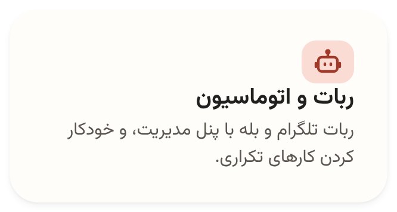</a><a href="https://nimbyte.ir/services/web">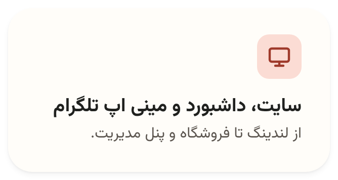</a> <a href="https://nimbyte.ir/services/telegram-ads">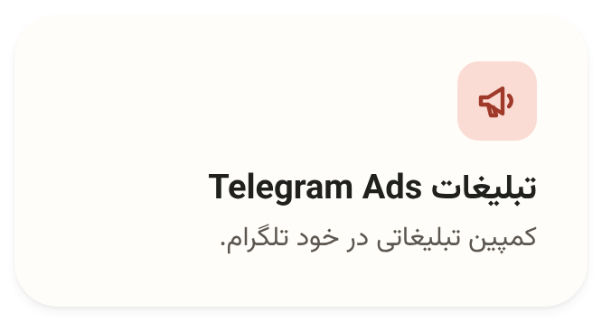</a><a href="https://nimbyte.ir/services/telegram-stars">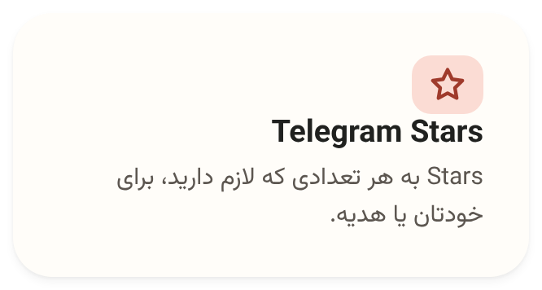</a><a href="https://nimbyte.ir/services/telegram-premium">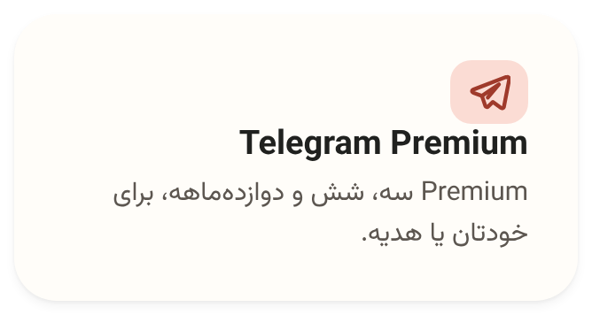</a> <a href="https://nimbyte.ir/portfolio/soundcloud-downloader-bot">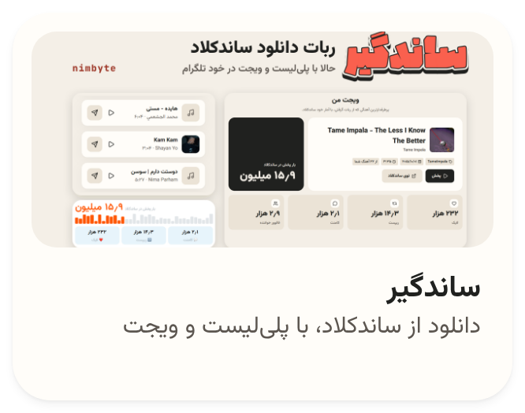</a><a href="https://nimbyte.ir/portfolio/adsprovider-bot">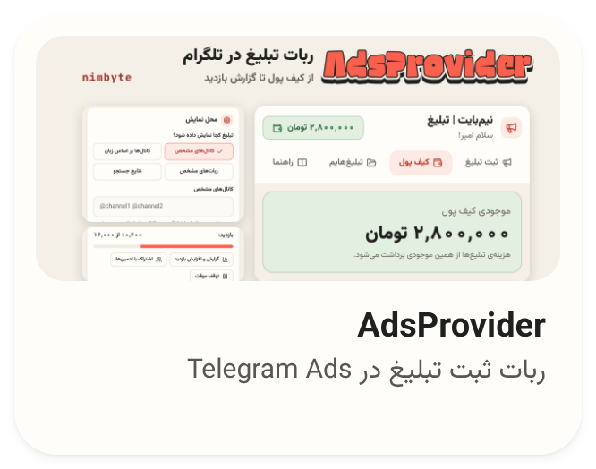</a><a href="https://nimbyte.ir/portfolio/nakoja-online-shop">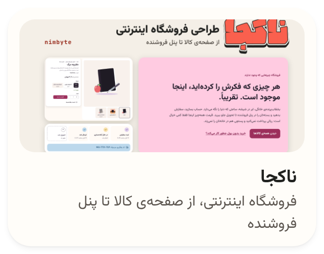</a> <a href="https://nimbyte.ir/#pricing">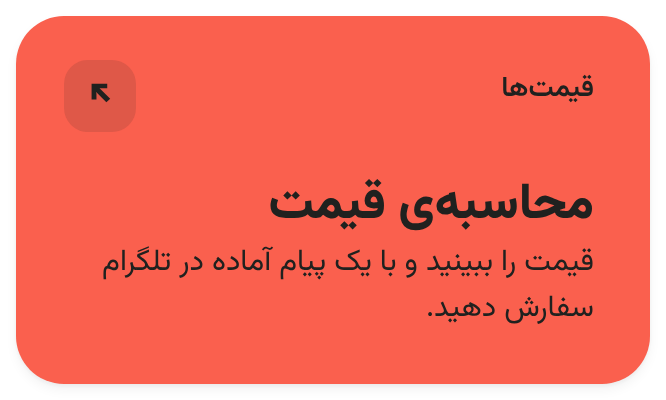</a><picture><source media="(prefers-color-scheme: dark)" srcset="profile/bento/v3/process-dark.png"/>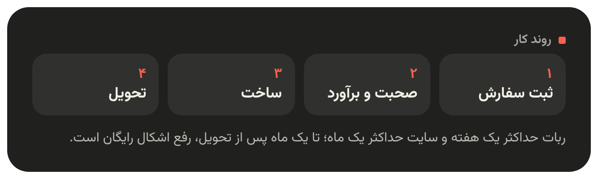</picture> <a href="https://nimbyte.ir/blog">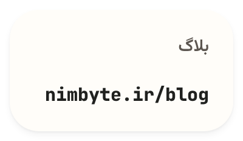</a><a href="https://www.instagram.com/nimbyte.ir/">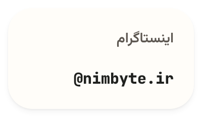</a>

